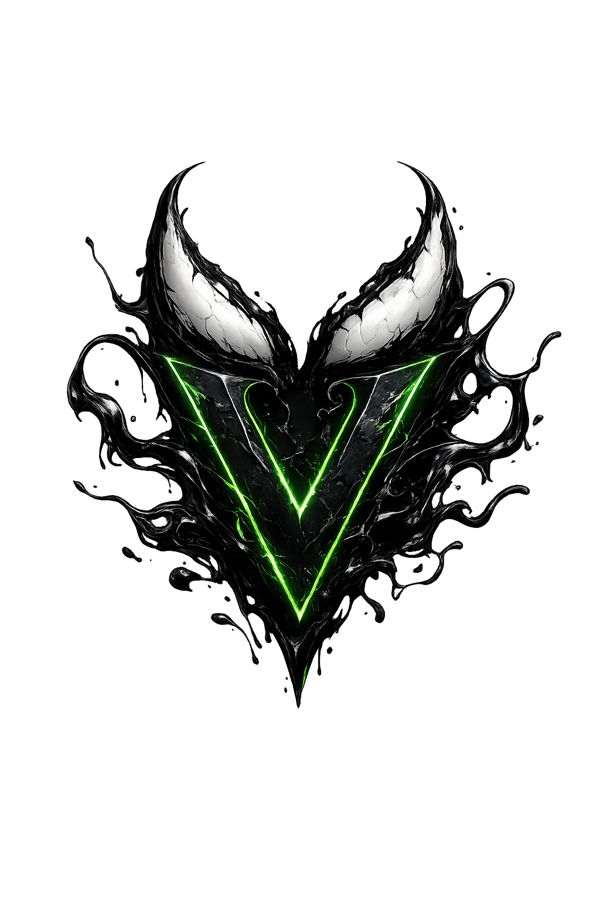
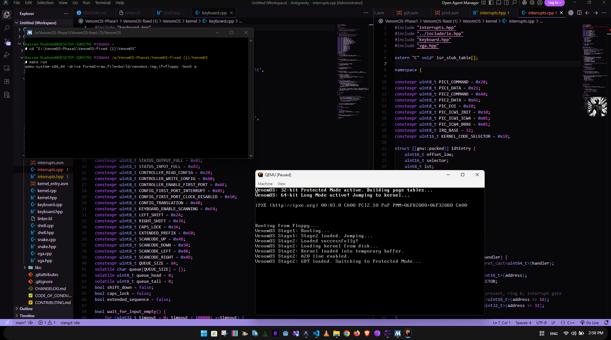
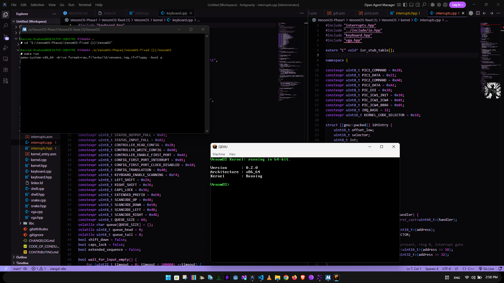
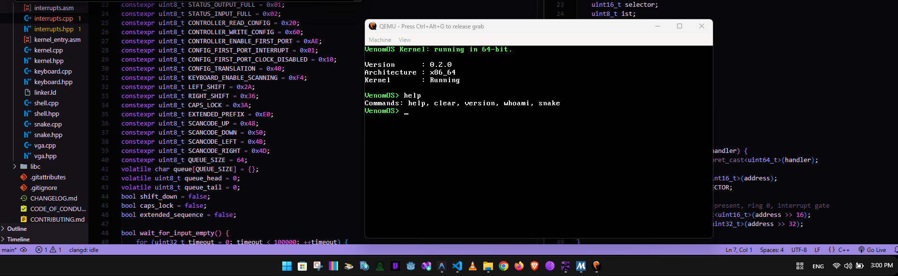
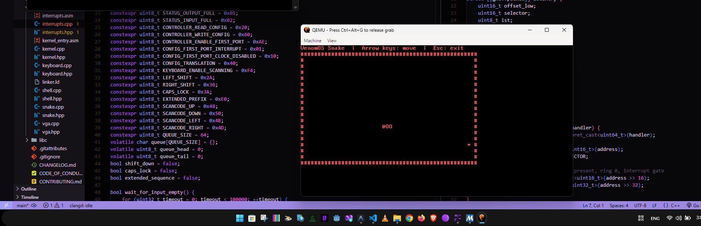

<div align="center">
  
  <h1 align="center">VenomOS 𝐕🕷️🕸️</h1>
  <p align="center"> VenomOS is a 64-bit educational operating system built from scratch using Assembly (NASM) and Modern C++. It boots from a custom BIOS bootloader into a freestanding Long Mode kernel with physical/virtual memory management, a heap, preemptive multitasking, ring 3 user mode with per-process address spaces, a persistent filesystem (VenomFS), an ELF64 loader, system calls, an interactive shell, and a built-in Snake game.</p>
</div>

<div align="center">

<div align="center">
  
  
  
  <br>
  
  
  <br>
   
</div>
<br>

<div align="center">
  
  [](https://instagram.com/@bassemmohamed_0)
  [](https://reddit.com/user/00xBassem)
  [](https://x.com/@Basem2Mohamed)
  
</div>
<p align="center">Made possible by <a href="https://bassemmohamed.pages.dev/"><strong>BassemMohamed</strong></a></p>

A 64-bit educational operating system built completely from scratch using **Assembly** and **Modern C++**.

No external operating system libraries.  
No GRUB.  
No Limine.  
No UEFI Framework.

Everything boots directly from BIOS.

</div>

# Screenshots
### Booting <br>


### VenomOS <br>


### Commands <br>


### Snake <br>


> The screenshots show the early boot, shell and Snake stages. They predate the memory
> manager, multitasking, filesystem and process features described below, so the boot
> log and the command list in a current build are longer than what is pictured.

---

# Features

**Boot**

- Custom Stage 1 and Stage 2 bootloaders (no GRUB / Limine / UEFI)
- BIOS disk loading, CPU feature check (CPUID / Long Mode support)
- BIOS `E820` physical memory map detection, handed to the kernel
- A20 line enable, Global Descriptor Table, Protected Mode transition
- Long Mode (64-bit) with the NX (no-execute) bit enabled
- Custom linker script, fully bootable 16 MiB disk image, QEMU ready

**Kernel**

- Freestanding C++17 kernel (no exceptions, no RTTI, no standard library)
- VGA text terminal with colors, scrolling and hardware cursor
- IDT, remapped 8259 PIC, hardware interrupts (timer + PS/2 keyboard) and CPU exception handling
- PS/2 keyboard driver (shift, caps lock, extended scancodes)
- Physical Memory Manager (bitmap frame allocator driven by the `E820` map)
- Paging: 4 KiB mappings, page protection, per-process address spaces
- Kernel heap (`kmalloc` / `kfree`) with block splitting, merging, and double-free / corruption detection

**Multitasking and processes**

- Preemptive, timer-driven round-robin scheduler
- Full process control block: PID, parent/child links, 7-state lifecycle, exit codes
- Zombie reaping (`wait`), sleeping, blocking, and an always-ready idle task
- Ring 3 user mode with a TSS and a per-task kernel stack (`RSP0`)
- `int 0x80` system call interface (`exit`, `write`, `sleep`)
- Validated user-pointer access (`usercopy`) so user code cannot trick the kernel into reading arbitrary memory
- Ring 3 faults (`#GP`, page faults, stack overflow into a guard page) terminate only the offending process

**Storage and executables**

- ATA PIO disk driver (primary master, polling)
- **VenomFS**: a custom persistent filesystem that self-formats on first boot
- ELF64 loader: validates the executable, maps every `PT_LOAD` segment into a private address space with `W^X` and NX applied, and runs it as a real ring 3 process

**User-facing**

- Interactive command shell
- Built-in Snake game

---

# Boot Process

```text
BIOS
 │
 ▼
Stage 1 Bootloader   (512 bytes at 0x7C00, loads Stage 2)
 │
 ▼
Stage 2 Bootloader
 │
 ├── Check CPU support (CPUID / Long Mode)
 ├── Load the kernel from disk into a temporary buffer
 ├── Detect the physical memory map (BIOS INT 15h, E820)
 ├── Enable A20
 ├── Load GDT (ring 0 + ring 3 segments + TSS descriptor)
 ├── Switch to Protected Mode
 ├── Relocate the kernel to 0x100000
 ├── Build identity-mapped page tables (first 1 GiB, 2 MiB pages)
 ├── Enable PAE, Long Mode and NX, then enable paging
 │
 ▼
64-bit Kernel (kernel_main)
 │
 ├── VGA, keyboard, IDT/PIC, timer
 ├── Physical Memory Manager, paging, heap
 ├── Tasks / scheduler
 ├── ATA driver, VenomFS
 └── Boot self-tests, then the interactive shell
```

For the full picture (memory layout, address spaces, scheduling, syscalls, ELF loading, VenomFS on-disk layout) see [docs/ARCHITECTURE.md](docs/ARCHITECTURE.md).

---

# Project Structure

```
VenomOS
│
├── boot/
│   ├── stage1.asm        Stage 1 boot sector
│   ├── stage2.asm        Mode switching, kernel relocation, page tables
│   ├── cpu_check.asm     CPUID / Long Mode check
│   ├── mmap.asm          E820 memory map detection
│   ├── a20.asm, gdt.asm, disk.asm, print.asm
│
├── kernel/
│   ├── kernel_entry.asm, kernel.cpp   Entry and boot sequence
│   ├── linker.ld, user_link.ld        Kernel and user-program linker scripts
│   ├── vga.*, keyboard.*              Terminal and input drivers
│   ├── interrupts.*                   IDT, PIC, exceptions, syscalls
│   ├── pmm.*, paging.*, heap.*        Physical, virtual and heap memory
│   ├── task.*, scheduler.*, task_switch.asm   PCBs, lifecycle, scheduling
│   ├── ring3.*, usercopy.*            User mode, TSS, safe user-memory access
│   ├── ata.*, fs.*                    Disk driver and VenomFS
│   ├── elf.*, process.*               ELF64 validation and process loading
│   ├── shell.*, snake.*               Shell and Snake game
│   └── user_program*.asm, demo_elf.asm, demo_hello_blob.asm,
│       stack_overflow_program*.asm    Ring 3 demo programs
│
├── include/                io.hpp, stdint.hpp, stddef.hpp
├── docs/                   Architecture, roadmap, step-by-step design notes
├── example.github/         CI workflow and issue / PR templates (see Known Limitations)
├── build/                  Generated by make (not committed)
└── Makefile
```

---

# Shell Commands

| Command | Description |
|---------|-------------|
| `help` | Show available commands |
| `clear` | Clear the screen |
| `version` | Show the OS version |
| `whoami` | Display the current user |
| `snake` | Launch the Snake game |
| `meminfo` | Show physical frame usage and kernel heap usage |
| `memtest` | Run a `kmalloc` / `kfree` allocate-write-verify-free test |
| `tasks` | Spawn two preemptively scheduled counter tasks (screen rows 20 and 21); the shell stays usable |
| `usermode` | Run the ring 3 demo as its own task: prints through a real syscall, then deliberately executes a privileged instruction and is terminated by the resulting `#GP` |
| `stackoverflow` | Run a ring 3 task that overflows its stack into the guard page and is terminated |
| `ls` | List files in VenomFS |
| `cat <file>` | Print a file |
| `write <file> <text>` | Create or overwrite a file |
| `rm <file>` | Delete a file |
| `run <file>` | Load an ELF64 executable from VenomFS into its own address space and run it as a process (try `run hello.elf`) |
| `ps` | List live processes: PID, parent PID, state, name, exit code for zombies |
| `wait` | Block until any child of the shell exits, reap it, and report its exit code |
| `sleep <ticks>` | Put the shell task to sleep (about 18 ticks per second) |

---

# System Calls

User programs enter the kernel with `int 0x80`. The syscall number goes in `rax`, arguments in `rdi` and `rsi`, and the result comes back in `rax`.

| Number | Name | Arguments | Behavior |
|--------|------|-----------|----------|
| 0 | `SYS_EXIT` | `rdi` = exit code | Terminates the process; the parent can reap the exit code with `wait` |
| 1 | `SYS_WRITE` | `rdi` = pointer, `rsi` = length | Prints to the terminal. The buffer is validated and copied from user memory; returns bytes written, or `-1` on a bad pointer or a length over 1 MiB |
| 2 | `SYS_SLEEP` | `rdi` = ticks | Sleeps the calling task; returns `0` |

Any other number returns `-1`.

---

# Build Requirements

- NASM
- x86_64-elf GCC Toolchain (`x86_64-elf-g++`, `x86_64-elf-ld`, `x86_64-elf-objcopy`)
- GNU Make
- QEMU (`qemu-system-x86_64`)

---

# Build

```bash
make
```

This produces `build/venomos.img`, a 16 MiB disk image. The build fails on purpose if the Stage 1 binary is not exactly 512 bytes, Stage 2 is not exactly 3072 bytes, or the kernel outgrows its 160-sector (80 KiB) budget.

# Run

```bash
make run            # opens the QEMU window
make run-headless   # no display, serial console on stdio
make clean          # remove build/ (this also discards the disk image and every file in VenomFS)
```

The image is booted as an IDE hard disk. On the first boot of a fresh image the kernel formats VenomFS automatically. Files then persist across reboots for as long as you keep the same image. `hello.elf` is rewritten into VenomFS on every boot.

---

# Technologies

- NASM Assembly
- C++17
- Freestanding Environment
- Custom Linker Script
- BIOS Boot
- x86_64 Architecture
- QEMU

---

# Project Status

| Phase | Status |
|-------|--------|
| Bootloader (Stage 1 + Stage 2, A20, GDT, Protected Mode, Long Mode) | Complete |
| C++ kernel and VGA terminal | Complete |
| Physical Memory Manager, paging, kernel heap | Complete |
| Interrupts, keyboard, shell | Complete |
| Ring 3 user mode, TSS, `int 0x80` syscalls | Complete |
| Preemptive multitasking (round-robin scheduler) | Complete |
| ATA driver and VenomFS | Complete |
| Per-process address spaces and process loading | Complete |
| ELF64 loader with hardened validation (`W^X`, NX, bounds checks) | Complete |
| Process lifecycle (PID, parent/child, states, exit codes, `wait`) | Complete |
| Syscall pointer validation (`usercopy`) | Complete |
| Snake game | Complete (bonus) |

Several items that earlier revisions of this README listed as "Planned" (Physical Memory Manager, Heap Allocator, Virtual Memory Manager, ATA Driver, Process Scheduler, Multitasking, User Mode, ELF Loader, System Calls) are implemented now. VenomFS is a custom filesystem, not FAT.

### Boot-time self-tests

`kernel_main()` runs real checks at boot and prints `PASS` / `FAIL` for each: paging, syscall pointer validation, task lifecycle, ring 3 stack selection, the ATA drive, the ELF loader and filesystem error handling. They run against the real kernel, not hardcoded strings.

---

# Known Limitations

These describe the code as it is today.

**Memory**

- The physical memory manager tracks only the first 1 GiB of RAM, and the boot identity map covers the same 1 GiB.
- ELF executables must be linked at or above `0x40000000` (1 GiB); lower addresses overlap the kernel's identity map and are rejected.

**Processes and scheduling**

- Single CPU core. Round-robin only, with a switch every 5 timer ticks, 128 task slots, no priorities.
- No mutexes, semaphores or other synchronization primitives yet.
- Only the shell (running in ring 0) can start processes. Ring 3 programs cannot spawn children, and `wait` reaps any child rather than a specific PID.
- Only three syscalls exist (`exit`, `write`, `sleep`). User programs cannot read input, open files, or query their PID.
- Executables must be static `ET_EXEC` ELF64 files: no PIE, no dynamic linking, at most 64 KiB, at most 16 `PT_LOAD` segments, and a fixed 16 KiB user stack with a guard page.
- A fault in ring 3 terminates that process with exit code `-1`. A CPU exception in the kernel itself halts the machine.

**Storage**

- VenomFS is flat (no directories) and limited to 64 files, 31-character names and 4 extents per file, on a fixed 16 MiB disk. There is no host-side tool to put files on the image, so executables currently reach the disk through the kernel (as `hello.elf` does).
- The ATA driver is polling PIO on the primary master drive only.

**Hardware**

- 8259 PIC only (no APIC), PS/2 keyboard only, VGA text mode only. No mouse, USB, networking or graphics.

**Build and tooling**

- The kernel image has a fixed 160-sector (80 KiB) budget, set in the `Makefile` and Stage 2.
- The kernel and `version` command report version `0.2.0`, while `CHANGELOG.md` tracks releases up to `0.5.0`; the two have not been reconciled yet.
- The CI workflow is stored in `example.github/workflows/build.yml`, not `.github/workflows/`, so GitHub does not run it. It also installs only `nasm`, `make` and QEMU, not the `x86_64-elf` cross-compiler the `Makefile` requires.
- `docs/` contains two files whose names differ only by letter case (`STEP-BY-STEP.md` and `step-by-step.md`). `STEP-BY-STEP.md` is the current one; the other is an older copy, and the pair cannot be checked out together on case-insensitive filesystems such as Windows or default macOS.

---

# Roadmap and Active Work

See [docs/ROADMAP.md](docs/ROADMAP.md) for the full list. Near-term candidates:

- A host-side tool to place programs on the disk image
- More syscalls (read, file access, `getpid`) and ring 3 process creation
- `wait` for a specific PID
- Synchronization primitives (mutex / semaphore)
- Non-contiguous VenomFS growth beyond four extents, and directories
- Making the CI workflow actually run, and reconciling version numbers

---

# Documentation

| Document | Contents |
|----------|----------|
| [docs/ARCHITECTURE.md](docs/ARCHITECTURE.md) | Current architecture: boot, memory, address spaces, tasks, syscalls, ELF loading, VenomFS layout |
| [docs/ROADMAP.md](docs/ROADMAP.md) | Completed, in-progress and planned work, plus known limitations |
| [docs/STEP-BY-STEP.md](docs/STEP-BY-STEP.md) | Phase-by-phase build log, including bugs found and fixed along the way |
| [CHANGELOG.md](CHANGELOG.md) | Release history |
| [CONTRIBUTING.md](CONTRIBUTING.md) | How to contribute |

---

# Purpose

VenomOS is an educational operating system project created to explore low-level software development, operating system internals, bootloaders, CPU architecture, memory management, interrupt handling, and kernel programming from scratch.

---

# License

MIT License

---

<div align="center">

Made with Bassem Mohamed using Assembly and Modern C++

</div>
